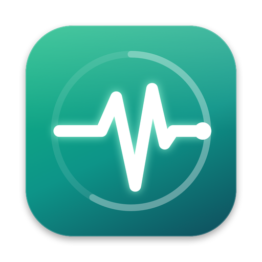

<p align="center">
  
</p>

<h1 align="center">Vitalis</h1>

<p align="center">Os sinais vitais do seu Mac, direto na barra de menus.</p>

---

O Vitalis mostra na barra de menus a temperatura da CPU e o uso de RAM (`33° · 50%`). Clicando no ícone, abre um painel com:

- **Temperaturas** de CPU, GPU, SSD e bateria, com a máxima e a média de cada grupo de sensores.
- **Memória** num gráfico de rosquinha: apps, sistema, comprimida, cache e livre, com a pressão de memória e o swap. Cache e livre aparecem hachurados porque, na prática, são memória disponível.
- **Disco**, numa barra que fica verde, amarela ou vermelha conforme o uso.
- **Apps que mais usam memória**, separando o que é do próprio app e o que foi iniciado por ele (por exemplo, o Terminal e tudo o que roda dentro dele). Clique num app para ver os processos.
- **Limpar RAM**, que sugere apps em segundo plano para encerrar, mostra quanto cada um libera e só encerra depois da sua confirmação.

## Instalação

1. Baixe ou gere o `Vitalis_0.1.0_aarch64.dmg` (veja [Desenvolvimento](#desenvolvimento)).
2. Abra o DMG e arraste o **Vitalis** para **Aplicativos**.
3. Abra o Vitalis. Ele não aparece no Dock, só na barra de menus.

O app tem assinatura ad-hoc e não é notarizado pela Apple. Num Mac diferente do que gerou o build, a primeira abertura é bloqueada: clique com o botão direito no app, escolha **Abrir** e confirme.

**Requisitos:** Mac com Apple Silicon e macOS 13 ou mais recente.

## Como a limpeza de RAM funciona

- Só aparecem apps comuns. Ficam de fora o app em foco, o Finder, o Dock, o próprio Vitalis e os apps que você proteger nas Configurações.
- Vêm pré-marcados os apps ocultos ou sem janelas abertas que usam mais de 100 MB.
- Cada app é fechado normalmente e pode pedir para você salvar documentos. Se algum não fechar, existe a opção "Forçar encerramento", que pede uma segunda confirmação.
- O Vitalis **não** limpa o cache nem a memória comprimida. O cache é liberado pelo macOS na hora em que um app precisa, e esvaziá-lo à força deixa o Mac mais lento. A memória comprimida pertence aos apps abertos e só é liberada quando eles fecham.

Para saber se falta memória de verdade, olhe a **pressão de memória** (o selo no cartão de Memória) e o **swap**. Pouca memória "Livre" é normal.

## Desenvolvimento

Requer [Bun](https://bun.sh) e [Rust](https://rustup.rs).

```bash
bun install
bun tauri dev        # roda o app em modo de desenvolvimento
bun tauri build      # gera o .app e o .dmg em src-tauri/target/release/bundle/
bun run typecheck    # checagem de tipos do frontend
cd src-tauri && cargo test
```

**Tecnologias:**
- Backend: [Tauri v2](https://tauri.app) e Rust, em três camadas por funcionalidade (presentation, domain, infrastructure).
- Frontend: React 19, TanStack Router e Query, Tailwind v4, shadcn/ui, Motion e Recharts.

Os detalhes de arquitetura, as fórmulas e as armadilhas conhecidas estão no [`CLAUDE.md`](CLAUDE.md).

## De onde vêm os dados

| Dado | Fonte |
|---|---|
| Temperatura de CPU e GPU | Sensores do SMC (`Tp*`/`Te*` para os núcleos, `Tg*` para a GPU) |
| Temperatura de SSD e bateria | Sensores HID do sistema |
| Memória | `host_statistics64`, com as mesmas fórmulas do Monitor de Atividade |
| Memória por app | `proc_pid_rusage` (footprint), agrupado pelo processo responsável |
| Disco | Capacidade disponível para uso importante, o mesmo valor que o Finder mostra |

A leitura de temperaturas usa APIs privadas da Apple, sem precisar de permissão de administrador. Ela funciona no macOS 26, mas pode parar de funcionar em atualizações futuras do sistema.
